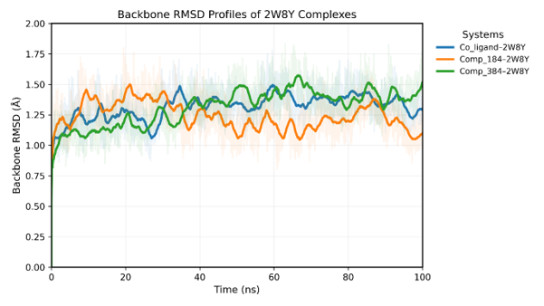
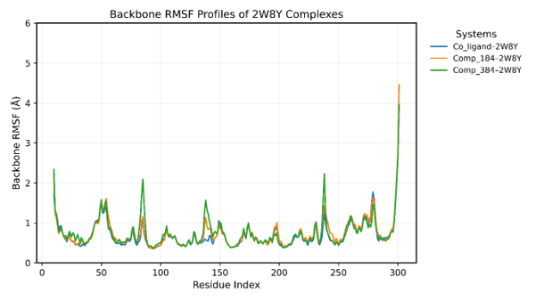
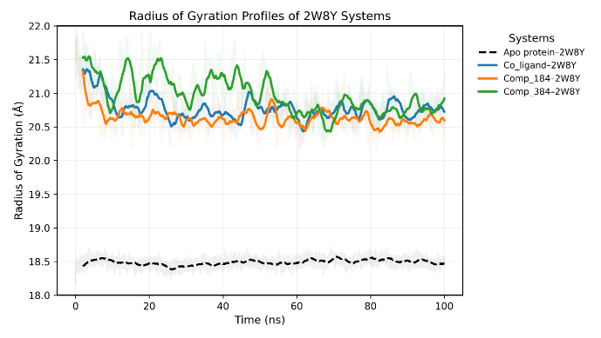
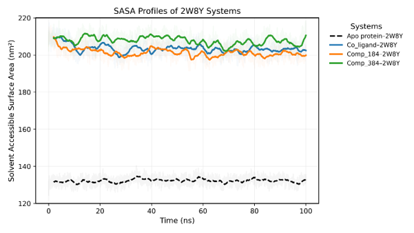
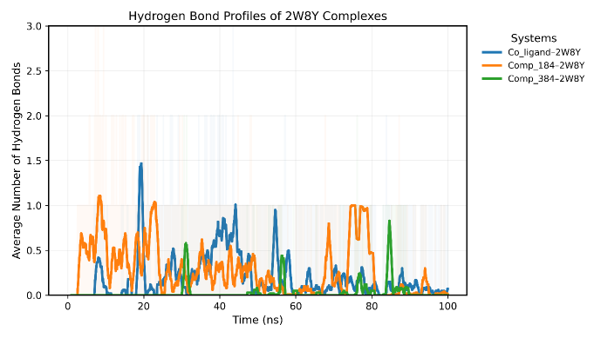

# Molecular Dynamics Simulation Results and Analysis

## 1. Overview

Molecular dynamics (MD) simulations were performed to investigate the structural stability and dynamic behaviour of the protein structure (PDB ID: 2W8Y) in its apo form and in complex with three ligands: the co-crystallized ligand (co-ligand), Compound 184, and Compound 384.

Each system was evaluated over a 100 ns simulation period using root mean square deviation (RMSD), root mean square fluctuation (RMSF), radius of gyration (Rg), solvent accessible surface area (SASA), and hydrogen-bond analysis.

## 2. Root Mean Square Deviation (RMSD)

RMSD analysis was used to evaluate changes in the protein's structural conformation throughout the 100 ns simulation.

The RMSD profiles of the simulated systems generally showed relatively stable trajectories, with values remaining within approximately 3.0 Å. The co-ligand-bound and ligand-bound systems exhibited variations during the simulation, followed by periods of comparatively stable behaviour.

Compound 184 showed a relatively stable RMSD profile, particularly during the later stages of the simulation. The co-ligand and Compound 384 systems also maintained comparatively stable trajectories, although fluctuations were observed at different intervals.

Overall, the RMSD profiles suggest that the protein structures maintained their general conformational stability during the simulations. However, RMSD alone does not establish binding affinity or prove that a ligand forms a stable complex.

**Figure 1.** RMSD profiles of the apo protein and protein–ligand complexes over 100 ns.

## 3. Root Mean Square Fluctuation (RMSF)

RMSF analysis was performed to examine residue-level flexibility and identify regions of the protein that exhibited greater structural fluctuations during the simulations.

The RMSF profiles showed broadly similar fluctuation patterns across the simulated systems. Most residues exhibited fluctuations below approximately 1.5 Å, while higher fluctuations were primarily observed in terminal and loop regions.

Residues within the protein's binding region generally displayed comparatively limited fluctuations, suggesting that these regions retained relative structural stability during the simulations.

Among the ligand-bound systems, Compound 184 exhibited comparatively lower residue fluctuations, while the co-ligand showed moderate fluctuations. Compound 384 displayed relatively higher fluctuations in some regions.

These observations indicate differences in the flexibility of the protein structures in the presence of the different ligands.

**Figure 2.** RMSF profiles showing residue-level fluctuations of the apo protein and protein–ligand complexes.

## 4. Radius of Gyration (Rg)

The radius of gyration was analysed to evaluate changes in the overall compactness of the protein structures during the simulations.

The Rg values of the four simulated systems, comprising the apo protein and the three protein–ligand complexes, were approximately 20.4–21.6 Å throughout the simulation period.

The apo protein maintained a relatively consistent Rg profile, while slight variations were observed in the ligand-bound systems. Compound 184 exhibited comparatively lower fluctuations, suggesting that its associated protein structure maintained relatively consistent compactness during the simulation.

Overall, the Rg profiles indicate that the protein structures retained their general compactness over the 100 ns simulation period.

**Figure 3.** Radius of gyration profiles of the apo protein and protein–ligand complexes over 100 ns.

## 5. Solvent Accessible Surface Area (SASA)

SASA analysis was performed to investigate changes in the solvent exposure of the protein structures during the simulations.

The ligand-bound systems generally exhibited higher SASA values than the apo protein. The profiles remained relatively stable throughout the simulation, although variations were observed among the different complexes.

Compound 184 showed comparatively lower fluctuations in SASA, whereas Compound 384 and the co-ligand-bound system exhibited greater variations.

These observations suggest differences in the solvent exposure of the protein structures in the presence of the different ligands.

**Figure 4.** SASA profiles of the apo protein and protein–ligand complexes over 100 ns.

## 6. Hydrogen-Bond Analysis

Hydrogen-bond analysis was performed to examine the formation and persistence of hydrogen-bond interactions between the protein and the respective ligands throughout the simulations.

The co-ligand exhibited intermittent hydrogen-bond formation, with notable periods of increased interactions between approximately 15–25 ns and 40–60 ns.

Compound 184 showed comparatively more frequent and sustained hydrogen-bond interactions, with a notable increase between approximately 70–85 ns. In contrast, Compound 384 exhibited relatively reduced hydrogen-bond persistence during the simulation.

The observed hydrogen-bond profiles suggest that Compound 184 maintained more persistent hydrogen-bond interactions with the protein than the other evaluated ligands under the simulated conditions.

**Figure 5.** Hydrogen-bond profiles of the co-ligand, Compound 184, and Compound 384 during the 100 ns simulations.

## 7. Overall Interpretation

The molecular dynamics simulations provided insights into the structural behaviour of the apo protein and its complexes with the co-ligand, Compound 184, and Compound 384.

Across the evaluated parameters, Compound 184 generally showed comparatively favourable profiles, including relatively stable RMSD behaviour, lower residue fluctuations, consistent compactness, and more persistent hydrogen-bond interactions.

The co-ligand also maintained relatively stable structural behaviour, while Compound 384 exhibited greater variations in some of the evaluated parameters.

Taken together, these findings suggest that Compound 184 demonstrated comparatively favourable dynamic behaviour among the evaluated compounds under the simulation conditions. Further experimental validation and complementary binding-energy analyses would be required to establish its potential as a promising ligand.
